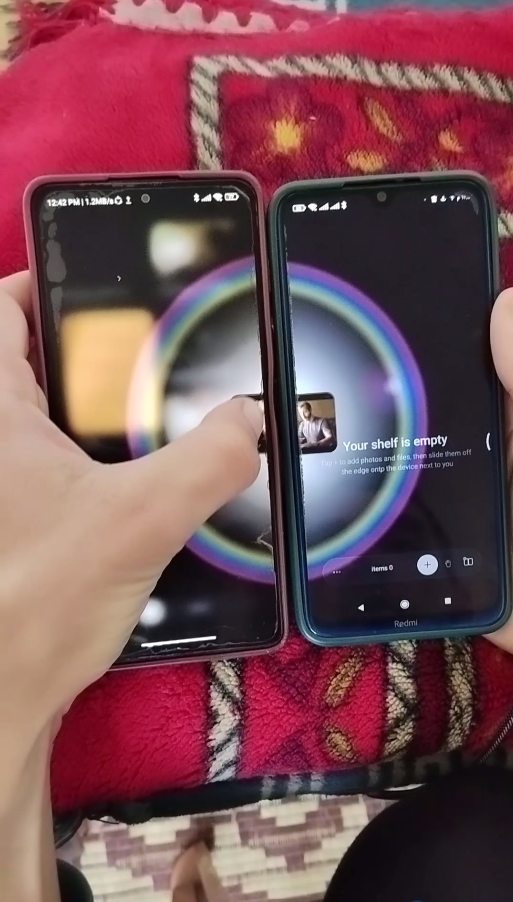
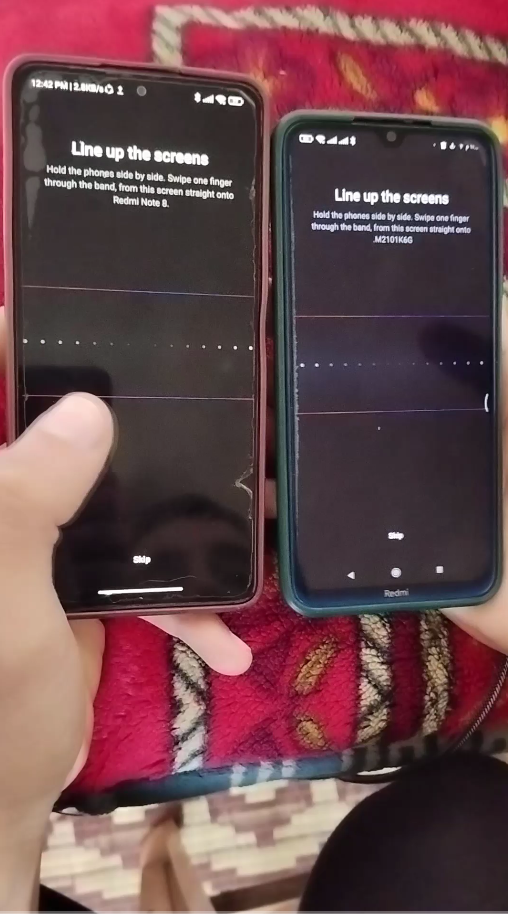
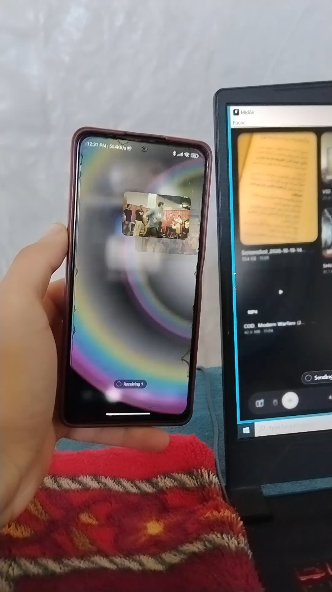
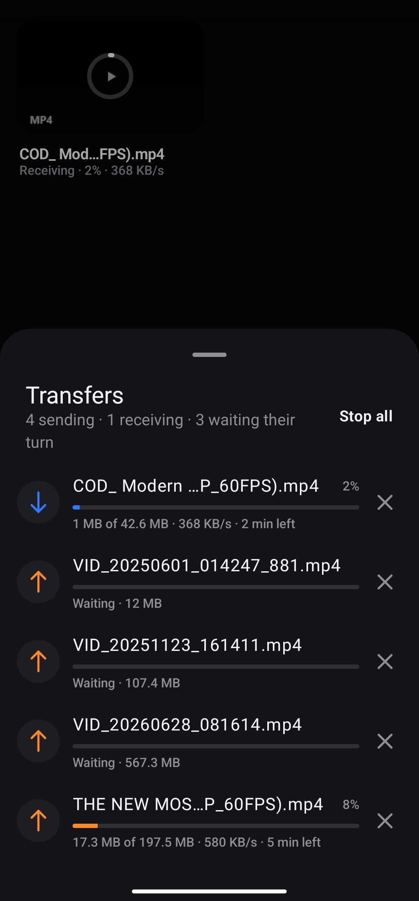
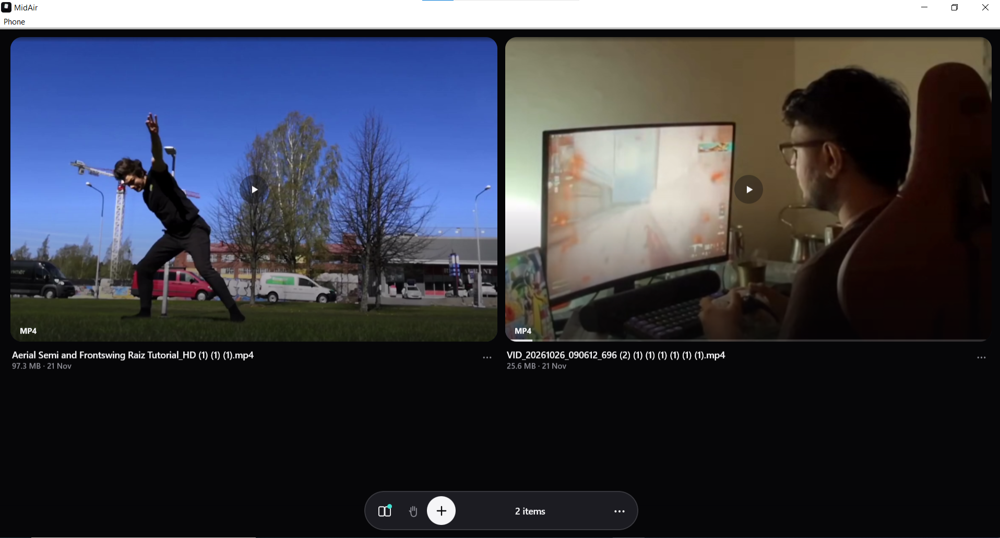
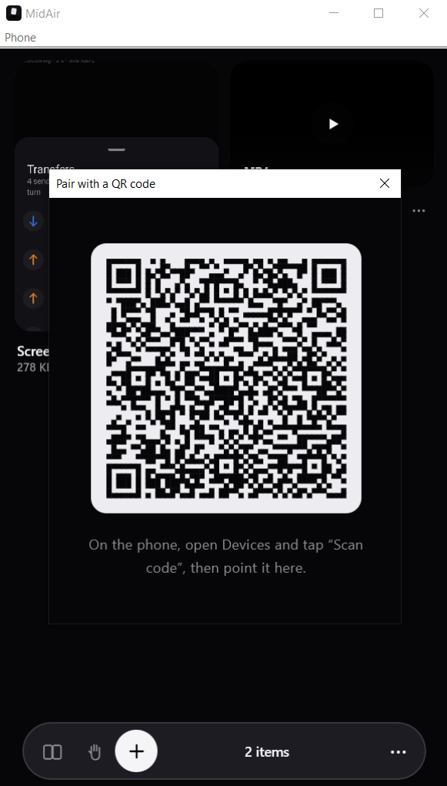
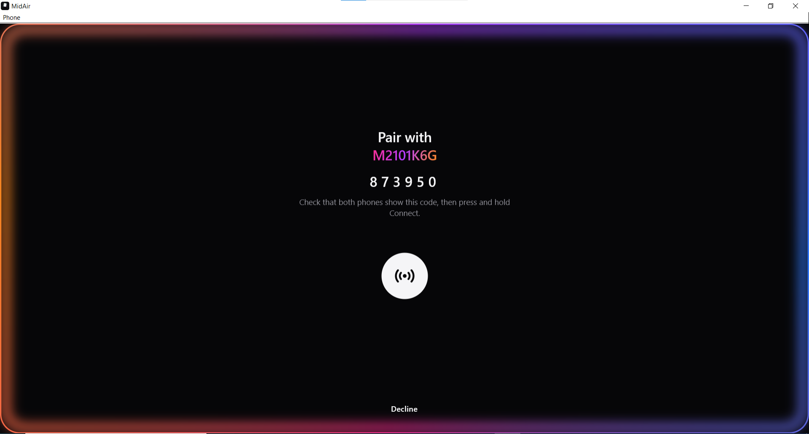
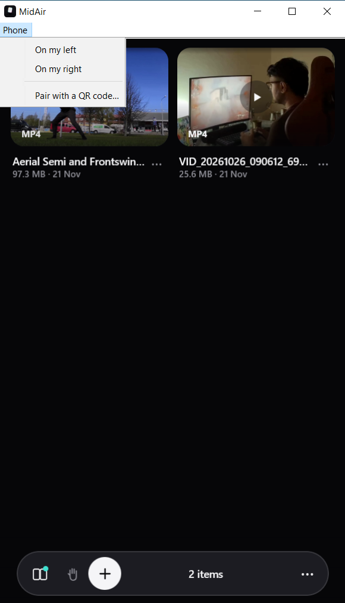
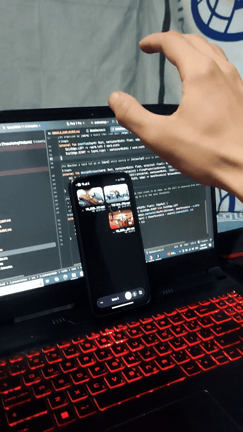
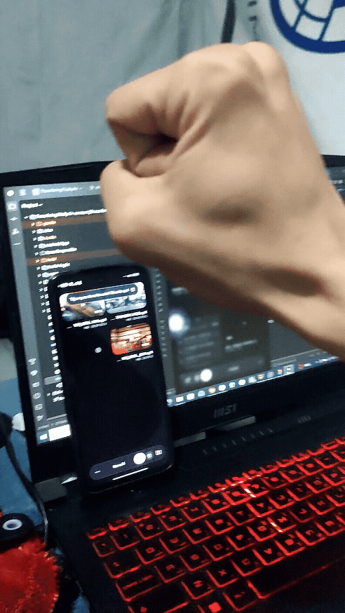

<div align="center">


# MidAir

**Slide a file off your phone's screen and watch it land on the device next to you.**


Built for the [Kotlin Multiplatform Contest](https://kotlinconf.com/contest/) (KotlinConf 2027).



▶️ **[Watch the demo videos](#demo-videos)**

</div>

---

## Contents

- [What it is](#what-it-is)
- [Screenshots](#screenshots)
- [Demo videos](#demo-videos)
- [Features](#features)
- [How to run](#how-to-run)
- [Judge's walkthrough](#judges-walkthrough)
- [Kotlin Multiplatform architecture](#kotlin-multiplatform-architecture)
- [How a slide works](#how-a-slide-works)
- [Tech stack](#tech-stack)
- [Tests](#tests)
- [Project structure](#project-structure)
- [Troubleshooting](#troubleshooting)
- [Credits and license](#credits-and-license)

## What it is

Sharing a file between two devices on the same desk still means menus, share sheets and pick-a-device lists.
MidAir makes it physical: put two devices side by side, press on a file and **drag it off the edge of the
screen**. As it crosses the gap, the card appears on the other device, following your finger, and lands on its
shelf. Videos keep playing while they cross, and with the camera on you can **grab a card with your fist and drop
it on the other device by opening your hand**.

It works **phone ↔ phone** (Android, over Nearby Connections, no Wi-Fi network needed) and **phone ↔ laptop**
(Android ↔ Windows, macOS or Linux, over the local network). The laptop and the phone find each other and pair the
same way two phones do; a QR code is there as a fallback.

## Screenshots

**Phones**

| Line-up | Receiving | Transfers sheet |
|:---:|:---:|:---:|
|  |  |  |

**Desktop**

| Desktop shelf | Pairing QR code on the laptop |
|:---:|:---:|
|  |  |
| **Pairing confirmation** | **Which side the phone is on** |
|  |  |

**Air gestures**

| Grab: close your hand into a fist | Release: open it over the other device |
|:---:|:---:|
|  |  |

## Demo videos

| Clip | Video |
|---|---|
| Phone ↔ phone: pair, line up, slide | [Phone Phone Workflow.mp4](demos/Phone%20Phone%20Workflow.mp4) |
| Phone ↔ laptop: pair, pick a side, slide both ways | [Desktop Phone Workflow.mp4](demos/Desktop%20Phone%20Workflow.mp4) |
| Air gestures between two phones | [Air Gesture Phones.mp4](demos/Air%20Gesture%20Phones.mp4) |
| Air gestures with the laptop's webcam | [dektop_air_gesture.mp4](demos/dektop_air_gesture.mp4) |
| Stopping a send from the Transfers sheet | [sending_cancel.mp4](demos/sending_cancel.mp4) |

## Features

- **Slide across the gap.** Drag a card off the edge; the other device draws the half that has crossed, at the
  same physical size and height, following your finger live.
- **Pair once, line up once.** Phones pair by pressing and holding *Connect* on both; one swipe from one screen
  onto the other measures where the other phone is: which side, how many millimetres away, how much higher or
  lower. A laptop pairs the same way: it finds the phone on the local network, both show the same code, and you
  press and hold *Connect*. Where the network keeps them from finding each other, the laptop shows a **QR code** and
  the phone scans it instead.
- **Any file.** Photos, videos, PDFs, documents. The card's motion and the file's bytes travel separately, so a big
  file never makes the card stutter, and bytes start moving before you let go.
- **Video that keeps playing.** A video card plays across both screens while it crosses, kept in step by a shared
  clock (ExoPlayer on Android, FFmpeg on the desktop).
- **Air gestures.** Turn on the camera: make a fist over a card to grab it, open your hand in front of the other
  device to drop it there. MediaPipe on Android, OpenCV with ONNX hand models on the desktop.
- **Slide away to remove.** Once the devices are lined up, only the edge facing the other device sends. Drag a card
  off the opposite edge and it leaves the shelf instead, with *Undo* to bring it back. On the laptop, the side you
  pick in the menu (**Phone → On my left / On my right**) sets which edge sends and which one removes. Skip the
  line-up on phones, or the side on the laptop, and **both edges send**: a card slid off either side crosses to the
  other device.
- **Clear the shelf.** One button in the shelf's bottom bar empties it, after a confirmation.
- **Stop one or stop all.** The *Transfers* sheet lists every file moving either way, each with its own *Stop*, and
  a **Stop all** button when more than one is running.
- **Transfers outlive the screen.** On Android, leave the app or lock the phone; a foreground service keeps files
  moving, with a progress notification and *Stop* per file.
- **Desktop over the local network.** The laptop and the phone talk over the local network (same Wi-Fi), through an
  authenticated, encrypted channel set up at pairing. Nearby Connections is only used phone ↔ phone.

## How to run

### Prerequisites

| | Needed |
|---|---|
| JDK | 17 or newer to start Gradle. The build provisions its own JDK through the Gradle daemon toolchain. |
| Android | Android Studio (latest stable) or the Android SDK with platform 37. A device with Android 8.0+ and Google Play services. **Two phones** for phone ↔ phone. |
| Desktop | Windows, macOS or Linux, x86-64 or ARM. A webcam for air gestures (optional). **Only tested on Windows**; the macOS build is untested (no Mac was available). |
| Network | For phone ↔ laptop: both on the same Wi-Fi / local network. Phone ↔ phone needs no network. |

```bash
git clone https://github.com/KhalidPS/MidAir.git
cd MidAir
```

### Android

```bash
./gradlew :androidApp:installDebug
```

Or open the project in Android Studio and run the `androidApp` configuration. Install it on both phones.

### Desktop

```bash
./gradlew :desktopApp:run
```

To try two desktop windows on one computer (each with its own data):

```bash
./gradlew :desktopApp:run -PairInstance=2
```

### Desktop installers

```bash
./gradlew :desktopApp:packageMsi   # Windows
./gradlew :desktopApp:packageDmg   # macOS
./gradlew :desktopApp:packageDeb   # Debian / Ubuntu
```

Output: `desktopApp/build/compose/binaries/main/<format>/`. Each installer must be built on its own OS. Packaging
needs a JDK that includes `jpackage`; Android Studio's bundled JBR does not. Point `JAVA_HOME` at a full JDK 17+
and add `--no-configuration-cache` if the cache still holds the old JDK path.

## Judge's walkthrough

<!-- TODO(media): one screenshot per step would help here. -->

**Phone ↔ phone (two Android phones)**

1. Open MidAir on both phones and allow *Nearby devices* and *Location* when asked.
2. Press and hold **Connect** on both phones until they pair.
3. Put the phones side by side and do the **Line up** swipe, from one screen straight onto the other. MidAir shows
   what it measured, e.g. "on your right, 11 mm away, its screen 4 mm lower".
4. Tap **+** and add a few photos, a PDF and a video.
5. Press a card, drag it off the edge facing the other phone, and watch it cross. Let go: it lands on the other
   shelf.
6. Slide a **video** and watch it keep playing while it crosses.
7. Drag a card off the **other** edge, away from the second phone: it leaves the shelf. Tap *Undo* to bring it back.
8. Open **Transfers** to see progress; slide a large file and press the Home button: it keeps going (a foreground
   service with a notification). Slide a few files and try **Stop all**.
9. Use the **Clear** button in the bottom bar to empty the shelf.

**Phone ↔ laptop**

1. Run the desktop app and open MidAir on the phone, both on the same Wi-Fi.
2. They find each other and show the same code. Check that it matches, then press and hold **Connect** on both.
   *Fallback:* if they don't find each other, choose **Phone → Pair with a QR code…** in the desktop menu bar, then
   on the phone tap **Scan code** and scan it.
3. Hold the phone beside the laptop screen's left or right edge and tell the desktop which side
   (**Phone → On my left / On my right**); the window moves against that edge.
4. Slide a card off the phone towards the laptop, then drag a file from the laptop shelf back to the phone.
5. On the laptop, drag a card off the edge away from the phone: it is removed from the shelf, with *Undo*.
   Switching the side in the menu swaps which edge sends and which removes.

**Only one phone?** A debug build includes the *Twin Simulator*, two virtual phones on one screen:
`adb shell am start -n com.kotlistine.midair/.SimulatorActivity`

**Air gestures**

1. Turn on air gestures from the shelf's bottom bar and allow the camera.
2. Hold an open hand in front of the camera, close it into a fist over a card: it lifts.
3. Open your hand in front of the other device: the card drops there.

## Kotlin Multiplatform architecture

MidAir follows the JetBrains default KMP structure: a `shared` library with all shared code, and one **thin shell
per platform** (`androidApp`, `desktopApp`). The shared code is split into `core/*` and `feature/*` modules, each
built for **Android** and **JVM (desktop)** from the same `commonMain`.

```
androidApp ─┐                       ┌─ desktopApp         thin shells: start Koin, open a window/activity
            └──────► shared ◄───────┘                     App(), navigation, list of Koin modules
                       │
     feature/pairing/presentation     feature/shelf/{presentation → domain ← data}
                       │
  core/{domain, presentation, designsystem, media, transfer/{domain, data, nearby, lan}}
```

- **Clean architecture per feature:** `presentation → domain ← data`. Domain depends on nothing; Koin wires the
  layers at start-up.
- **MVI** in every screen: `State`, `Action`, `Event`, a `ViewModel` and a stateless, previewable `Screen`.
- **Platform code behind common contracts.** Mostly an interface in `commonMain` with one implementation per
  platform, bound in Koin (`HandTracker`, `VideoEngine`, `LanDiscovery`, `ReceivedFileStore`). `expect`/`actual`
  only for small UI pieces (a glow effect, image decoding, the video surface).
  ```kotlin
  // core/designsystem › commonMain › effects/FlowingGlow.kt
  internal expect fun flowingGlowBrush(): FlowingGlowBrush?

  // FlowingGlow.android.kt → an AGSL RuntimeShader on Android 13+
  // FlowingGlow.jvm.kt     → the desktop draws the plain turning sweep for now:
  internal actual fun flowingGlowBrush(): FlowingGlowBrush? = null
  ```
- **A custom middle source set.** `core/transfer/lan` has `jvmSharedMain`, shared by Android and the desktop (both
  JVMs): sockets and encryption are written once for both.

### How much is shared

Lines of Kotlin in `src/main` code (tests not counted):

| Where | Lines | Runs on |
|---|---:|---|
| `commonMain` | 13,053 | Android + desktop |
| `jvmSharedMain` | 1,839 | Android + desktop |
| `androidMain` | 4,676 | Android only |
| `jvmMain` | 1,672 | Desktop only |
| App shells (`androidApp`, `desktopApp`) | 1,303 | One platform each |

**About 66 % of the app's code runs on both platforms** (58 % in `commonMain` alone). The UI, navigation,
ViewModels, slide geometry, wire protocol, video sync, gesture detection and the database are all shared. What stays
per platform is what has to: Nearby Connections, the camera and hand models, the video decoder, file storage.

| Contract (common) | Android | Desktop |
|---|---|---|
| `PeerLink` | Nearby Connections, LAN | LAN |
| `LanDiscovery` | `NsdManager` | JmDNS |
| `VideoEngine` | Media3 ExoPlayer | FFmpeg via JavaCV, drawn with Skia |
| `HandTracker` | MediaPipe, front camera | OpenCV + ONNX palm and hand models, webcam |
| `ReceivedFileStore` | MediaStore / Downloads | `~/Downloads/TransferingFileByAir` |
| `ShelfDatabaseFactory` | Room (Android) | Room (bundled SQLite) |

## How a slide works

1. **Finger input** (`SlideGesture`) becomes *lift / move / drop* messages.
2. **Geometry** (`SlideGeometry`, `Crossing`, `ScreenDensity`) turns a position on device A into millimetres, then
   into pixels on device B, so the card keeps its real size across different screens.
3. **Messages** (`SlideMessage`, a sealed interface) are mapped to DTOs and encoded as CBOR with
   kotlinx.serialization.
4. **Transport:** `CombinedPeerLink` routes them over Nearby (phone ↔ phone) or the encrypted LAN link (phone ↔
   laptop).
5. **Bytes travel apart** from the motion: the receiver reads byte ranges through `MediaChannel`, so a video can
   start playing before the whole file has arrived.
6. **Receiving side** (`IncomingSlide`) draws the half-card entering from its edge, then lands it on the shelf.

## Tech stack

| Area | Libraries |
|---|---|
| Language & build | Kotlin 2.4, Kotlin Multiplatform, Gradle convention plugins in `build-logic`, AGP 9 KMP library plugin |
| UI | Compose Multiplatform, Material 3, JetBrains Navigation & Lifecycle (ViewModel) |
| Async | kotlinx.coroutines, Flow |
| DI | Koin |
| Data | Room (multiplatform) + bundled SQLite, kotlinx.serialization (CBOR), kotlinx-datetime |
| Images | Coil 3 |
| Transport | Google Nearby Connections (Android), sockets + JmDNS / NSD (LAN), ZXing (QR codes), CameraX (QR scanning) |
| Video | Media3 ExoPlayer (Android), FFmpeg via JavaCV (desktop) |
| Hand tracking | MediaPipe Tasks (Android), OpenCV dnn + ONNX models (desktop) |
| Tests | kotlin.test, AssertK, Turbine |

## Tests

```bash
./gradlew testAndroidHostTest jvmTest
```

The same `commonTest` code (~8,300 lines) runs on **both** targets: codec round trips, slide geometry, the gesture
detector, playback sync, the transfer board and the ViewModels with fakes.

## Project structure

```
androidApp/          Android shell: Application, Activity, foreground transfer service
desktopApp/          Desktop shell: main(), window, phone placement, QR window, installer config
shared/              App(), navigation, every Koin module in one list
core/
  domain/            Result & error types, the shelf item model
  presentation/      UI helpers, image loading (expect/actual)
  designsystem/      Theme, colours, motion tokens, effects
  media/             VideoEngine: ExoPlayer / FFmpeg
  transfer/
    domain/          PeerLink, SlideMessage, geometry, TransferBoard
    data/            DTOs, CBOR codec, CombinedPeerLink
    nearby/          Nearby Connections link (Android)
    lan/             Encrypted LAN link (Android + desktop)
feature/
  pairing/           Pairing, line-up and QR screens
  shelf/             The shelf: presentation / domain / data
  simulator/         Debug-only: two virtual phones on one screen
build-logic/         Convention plugins (KMP library, Compose, feature)
baselineprofile/     Android baseline profile
```

**Debug tool:** a debug build includes a *Twin Simulator*, two virtual phones on one screen, for trying the slide
with one device:

```bash
adb shell am start -n com.kotlistine.midair/.SimulatorActivity
```

## Troubleshooting

| Problem | Try |
|---|---|
| Phones don't find each other | Allow *Nearby devices* and *Location*, turn on Bluetooth and Wi-Fi, keep the phones close. |
| Phone can't reach the laptop | Both must be on the same network; some guest or office Wi-Fi blocks devices from seeing each other. Allow the desktop app through the firewall, or pair with the QR code (**Phone → Pair with a QR code…**). |
| Air gestures don't start on Windows | Check *Settings → Privacy → Camera*; the app offers *Open settings* when the camera is blocked. |
| `jpackage` missing when packaging | Use a full JDK (not Android Studio's JBR) as `JAVA_HOME`, and run with `--no-configuration-cache`. |

## Credits and license

- Hand models: palm detection and hand landmarks from [OpenCV Zoo](https://github.com/opencv/opencv_zoo) (desktop),
  MediaPipe gesture recognizer (Android).
- FFmpeg through [JavaCV](https://github.com/bytedeco/javacv) (LGPL build, decoders only).

MidAir is released under the [MIT License](LICENSE).
