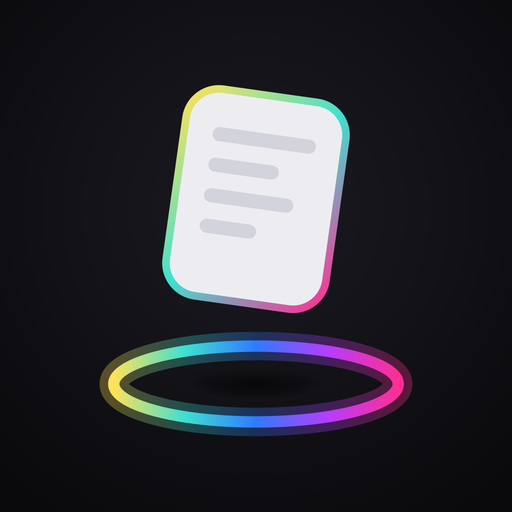

<div align="center">



# MidAir

**Slide a file off your phone's screen and watch it land on the device next to you.**


Built for the [Kotlin Multiplatform Contest](https://kotlinconf.com/contest/) · Android + Desktop (Windows, macOS, Linux)

</div>

<!-- TODO before submission: replace with a GIF or screenshots of MidAir itself, and the screencast link. -->
> 🎥 **Screencast (3–5 min):** _link coming_
>
> 📸 **Screenshots:** _coming_

---

## Contents

- [What it is](#what-it-is)
- [Key features](#key-features)
- [How Kotlin Multiplatform is used](#how-kotlin-multiplatform-is-used)
- [Architecture](#architecture)
- [Tech stack](#tech-stack)
- [Run it](#run-it)
- [Judge's walkthrough: try the key features](#judges-walkthrough-try-the-key-features)
- [Tests](#tests)
- [Project structure](#project-structure)
- [Troubleshooting](#troubleshooting)
- [Credits and licence](#credits-and-licence)

---

## What it is

Sending a file to the phone or laptop right beside you still means menus: share sheet, pick a device, wait,
open a notification. MidAir turns it into a physical gesture.

Put two devices side by side and pair them. Every file sits on a **shelf** as a card. Press a card, drag it to
the edge of the screen, and keep going. The card **crosses the gap**: its first half appears on the other
device's edge, follows your finger there in real time, and lands on that device's shelf when you let go. The
file's bytes travel underneath, separately from the motion, so even a large video slides smoothly. A video
**keeps playing** while it straddles the two screens.

You can also skip the touch completely: close your hand into a **fist** in front of the camera to grab a card,
then **open your hand** in front of the other device to drop it there.

It works phone ↔ phone (Android, over Google Nearby Connections) and phone ↔ laptop (Android ↔ desktop, over the
local network, paired by scanning a QR code).

## Key features

| | Feature | What happens |
|---|---|---|
| 🃏 | **Slide across the gap** | A card dragged off the edge enters the other screen at the same height and speed, sized in real millimetres so it looks continuous across two different displays. |
| 📐 | **Line-up** | After pairing, one swipe from one screen straight onto the other measures where the other phone is: which side, how many millimetres away, and how much higher or lower its screen sits. On a laptop you pick the side the phone sits on. |
| 🎬 | **Live video across two screens** | A playing video keeps playing while half of it is on each device. The second device follows the first one's clock. |
| ✊ | **Air gestures** | Fist to grab, open hand to drop, using the phone camera (MediaPipe) or the laptop webcam (OpenCV + ONNX models). |
| 💻 | **Phone ↔ laptop** | The desktop app shows a QR code; the phone scans it and the two pair over Wi-Fi with an encrypted link. |
| 📦 | **Real transfers** | Files go one at a time at full link speed, with progress, speed and time left. They keep going with the screen off (an Android foreground service), and each can be stopped. |
| 🗂️ | **A persistent shelf** | Received files are saved (Downloads on Android) and stay on the shelf, stored in a Room database shared by both platforms. |

## How Kotlin Multiplatform is used

MidAir is one Kotlin codebase with two thin platform shells. Everything a user sees and every rule about how a
slide behaves is written once, in `commonMain`.

**Shared code, counted in lines of Kotlin (main source sets, tests excluded):**

| Source set | Runs on | Lines | Share |
|---|---|---:|---:|
| `commonMain` | Android **and** desktop | 13,053 | **58 %** |
| `jvmSharedMain` (custom) | Android **and** desktop (both JVMs) | 1,839 | 8 % |
| `androidMain` + `androidApp` | Android only | 5,327 | 24 % |
| `jvmMain` + `desktopApp` | Desktop only | 2,324 | 10 % |

**About 66 % of the app's code runs on both platforms.** Another 8,292 lines of `commonTest` run on both too:
the same tests execute on the Android host and on the JVM.

**What is shared:**
- All UI: every screen, the slide animations, the design system, written in Compose Multiplatform.
- All ViewModels and state (MVI: `State` / `Action` / `Event`), and navigation.
- The slide protocol: messages, the geometry that maps one screen's position onto another's, and the CBOR codec.
- The LAN protocol, its encryption, and its sockets (in `jvmSharedMain`, one copy for Android and desktop).
- The hand-gesture logic: the fist/open detector, smoothing, and the maths that decodes the ONNX palm and
  landmark models.
- The video sync logic (`PlaybackFollower`), and the database (Room KMP).

**What is platform-specific, and why:**

| Concern | Android (`androidMain`) | Desktop (`jvmMain`) |
|---|---|---|
| Phone ↔ phone link | Google Nearby Connections | — (desktop pairs over LAN) |
| LAN discovery | `NsdManager` | JmDNS |
| Video engine | Media3 ExoPlayer | FFmpeg via JavaCV, drawn with Skia |
| Hand tracking | MediaPipe on the front camera | OpenCV webcam + two ONNX models |
| Saving received files | MediaStore (Downloads) | `~/Downloads/TransferingFileByAir` |
| Keeping transfers alive | Foreground service + notifications | Not needed |
| Pairing code | Scans the QR code (CameraX + ZXing) | Shows the QR code |

**Two ways to reach platform code from common code**, each used where it fits:
1. **An interface in common, one implementation per platform, bound in Koin.** This is the default for anything
   with behaviour, for example `HandTracker` → `CameraHandTracker` (Android) / `WebcamHandTracker` (desktop),
   or `VideoEngine` → `ExoVideoEngine` / `FfmpegVideoEngine`.
2. **`expect` / `actual`** for small UI-level pieces, such as the glow effect, image decoding and the video
   surface:

```kotlin
// core/designsystem/src/commonMain/.../effects/FlowingGlow.kt
internal expect fun flowingGlowBrush(): FlowingGlowBrush?

// …/FlowingGlow.android.kt → an AGSL RuntimeShader on Android 13+
// …/FlowingGlow.jvm.kt
/** The desktop draws the plain turning sweep for now. */
internal actual fun flowingGlowBrush(): FlowingGlowBrush? = null
```

**A custom source set.** `core/transfer/lan` adds `jvmSharedMain` between `commonMain` and the Android and JVM
targets. Sockets and `javax.crypto` exist on both JVMs, so the encrypted LAN link is written once for both, while
`commonMain` stays pure Kotlin, ready for an iOS target.

**Ready for iOS.** The shells follow the JetBrains default structure (`shared` + `androidApp` + `desktopApp`). An
iOS target would need a shell, an implementation of each platform interface above, and one Koin line each. No
screen, ViewModel or protocol code would change.

## Architecture

Clean Architecture per feature, with MVI in the presentation layer and Koin for dependency injection.

```
androidApp ─┐                         ┌─ desktopApp        thin shells: start Koin, open App()
            └────────►  shared  ◄─────┘                    App(), NavHost, the list of Koin modules
                          │
   feature/pairing/presentation     feature/shelf/{presentation → domain ← data}
                          │
   core/{domain, presentation, designsystem, media, transfer/{domain, data, nearby, lan}}
```

- **Dependency rule:** `presentation → domain ← data`. The domain depends on nothing; presentation never sees
  data. Koin wires them together at start-up.
- **Errors as values:** a `Result<T, DataError>` type; no exceptions cross the data layer.
- **Motion and bytes are separate.** The card's movement travels as small `SlideMessage`s on the peer link; the
  file travels as byte-range reads on a `MediaChannel`. A large file never makes the card stutter, and a video
  can start playing before it has fully arrived.
- **One link, two transports.** `CombinedPeerLink` routes to Nearby (phone ↔ phone) or LAN (phone ↔ laptop).
  The shelf only sees a `PeerLink`; adding a third transport would not touch it.
- **Gradle convention plugins** in `build-logic` give every module its targets and setup
  (`KmpLibrary` → `KmpCompose` → `KmpFeature`), and all versions live in `gradle/libs.versions.toml`.

## Tech stack

| Layer | Technology |
|---|---|
| Language | Kotlin 2.4, coroutines and Flow, kotlinx.serialization (CBOR), kotlinx-datetime |
| UI | Compose Multiplatform 1.12, Material 3, JetBrains Navigation and Lifecycle (ViewModel) |
| DI | Koin 4.2 |
| Database | Room 2.8 (KMP) with the bundled SQLite driver |
| Images | Coil 3 |
| Phone ↔ phone | Google Play Services Nearby Connections |
| Phone ↔ laptop | TCP sockets + `javax.crypto`, NSD (Android) / JmDNS (desktop) discovery, ZXing QR codes |
| Video | Media3 ExoPlayer (Android), FFmpeg through JavaCV (desktop) |
| Hand tracking | MediaPipe Tasks (Android), OpenCV dnn + ONNX models from opencv_zoo (desktop) |
| Camera | CameraX (Android), OpenCV videoio (desktop) |
| Build | Gradle 9.6, AGP 9.4 (`com.android.kotlin.multiplatform.library`), convention plugins, version catalog |
| Tests | kotlin.test, AssertK, Turbine |

## Run it

### Prerequisites

- **JDK 17 or newer** to start Gradle. Gradle downloads the JDK it builds with by itself
  (`gradle/gradle-daemon-jvm.properties`).
- **Android Studio** (a recent version that supports AGP 9.4) with the **Android SDK 37** installed. The repo has
  no `local.properties`; Android Studio creates it, or create it yourself with `sdk.dir=/path/to/Android/sdk`.
- **For Android:** a phone with Android 8.0 (API 26) or newer and Google Play Services. Two phones to slide
  between them, or one phone and a computer.
- **For phone ↔ laptop:** both on the **same Wi-Fi network**, with a network that lets devices see each other
  (many guest or corporate networks don't).

```bash
git clone <repository-url>
cd <repository-folder>
```

### Android

```bash
./gradlew :androidApp:installDebug
```

Or open the project in Android Studio, pick the **androidApp** run configuration and press Run. Install it on
both phones.

### Desktop (Windows, macOS, Linux)

```bash
./gradlew :desktopApp:run
```

To try pairing two desktop windows on one computer, start a second copy with its own data:

```bash
./gradlew :desktopApp:run -PairInstance=2
```

### Desktop installer (optional)

```bash
./gradlew :desktopApp:packageDistributionForCurrentOS   # .msi on Windows, .dmg on macOS, .deb on Linux
```

The installer is written to `desktopApp/build/compose/binaries/main/`. Packaging needs a full JDK that includes
`jpackage`; Android Studio's bundled JDK does not. If Gradle reports `'jpackage' is missing`, see
[Troubleshooting](#troubleshooting).

> **Windows:** a `.bat` launcher is included, so use `gradlew.bat` (or `.\gradlew`) in place of `./gradlew`.

## Judge's walkthrough: try the key features

### 1. Pair two phones and slide a file (≈ 2 min)

1. Open MidAir on both phones and allow the nearby-devices / location permissions when asked.
2. On both, open pairing (**Pair with a device nearby**), then press and hold **Connect** until they find each
   other.
3. **Line up:** lay the phones side by side and, when asked, swipe from one screen straight onto the other in one
   smooth move. MidAir shows what it measured, for example "on your right, 11 mm away, its screen 4 mm lower".
4. On one phone, tap **+** (**Add files**) and pick a photo or video.
5. Press the card, drag it toward the other phone, and keep going past the edge. Watch it enter the other screen
   and follow your finger. Let go: it lands on the other phone's shelf, and the file is saved to Downloads.

### 2. Slide a video while it plays

Add a video, tap its card to play it, then slide it across. Halfway, half of the video plays on each phone, in
step.

### 3. Air gestures

1. Tap the hand button in the shelf's bottom bar (**Turn on air gestures**) and allow the camera.
2. Hold your open hand in front of the camera, over a card, then close it into a **fist**: the card is grabbed.
3. Move to the other device and **open your hand** in front of it: the card drops there.

On the desktop, MidAir asks for consent before it uses the webcam. If Windows' camera privacy settings block it,
MidAir says so and offers to open them.

### 4. Phone ↔ laptop

1. Start the desktop app (`./gradlew :desktopApp:run`) on a computer on the same Wi-Fi as the phone.
2. In the desktop window's menu, choose **Phone → Pair with a QR code…**: it shows a code.
3. On the phone's pairing screen, tap **Scan code** and point the camera at it.
4. Hold the phone against the laptop screen's left or right edge and tell the desktop which one
   (**Phone → On my left / On my right**). The window moves against that edge.
5. Slide cards across, both ways.

### 5. Transfers

Slide a few large files at once and pull down the notification shade: there is a summary with **Stop all**, plus
one notification per file with progress and **Stop**. Turn the screen off; the transfers keep going.

### No second phone?

Debug builds include a **Twin Simulator**, a developer tool that fakes two phones side by side on one screen, to
try the slide without a second device:

```bash
adb shell am start -n com.kotlistine.midair/.SimulatorActivity
```

## Tests

```bash
./gradlew testAndroidHostTest jvmTest
```

The `commonTest` suites run twice, once on each platform. Good places to start reading:
- `core/transfer/data` · codec round-trips for every slide message.
- `feature/shelf/domain` · `PlaybackFollower` (video sync) and the air-gesture detector.
- `feature/shelf/presentation` · the shelf ViewModel driven through fakes (`FakeHandTracker`, a fake peer link).
- `feature/pairing/presentation` · `PairingViewModelTest` with Turbine and AssertK.

## Project structure

```
├── androidApp/                 Android shell: Application, MainActivity, transfer foreground service
├── desktopApp/                 Desktop shell: main(), window docking beside the phone, QR window, installer config
├── shared/                     App() root, NavHost and the list of Koin modules, for both shells
├── core/
│   ├── domain/                 Result/DataError, ShelfItem and other shared models
│   ├── presentation/           MVI helpers, image loading (expect/actual)
│   ├── designsystem/           Theme, colours, motion tokens, shader effects (expect/actual)
│   ├── media/                  VideoEngine contract; ExoPlayer and FFmpeg engines
│   └── transfer/
│       ├── domain/             PeerLink, SlideMessage, crossing geometry, TransferBoard
│       ├── data/               DTOs + CBOR codec, CombinedPeerLink, file spans
│       ├── nearby/             Google Nearby Connections link (Android)
│       └── lan/                LAN protocol (common), encrypted sockets (jvmSharedMain), discovery per platform
├── feature/
│   ├── pairing/presentation/   Pairing, QR scan/show and line-up screens
│   ├── shelf/{domain,data,presentation}/   The shelf: slides, transfers, video, air gestures, Room database
│   └── simulator/              Debug-only Twin Simulator
├── build-logic/convention/     Gradle convention plugins (KMP library → Compose → feature)
├── baselineprofile/            Baseline profile for Android start-up
└── gradle/libs.versions.toml   Every dependency version
```

## Troubleshooting

| Problem | Fix |
|---|---|
| `SDK location not found` | Open the project once in Android Studio, or create `local.properties` with `sdk.dir=…`. |
| `'jpackage' is missing` when packaging the desktop app | Gradle is running on a JDK without `jpackage` (e.g. Android Studio's). Point `JAVA_HOME` at a full JDK 17+ (Temurin, Zulu…), then run `./gradlew --stop` and package again with `--no-configuration-cache`. |
| The phones don't find each other | Allow all permissions, turn on Bluetooth, Wi-Fi and location, and keep the phones close. |
| The phone can't reach the laptop | Use the same Wi-Fi network, and allow the desktop app through the computer's firewall. |
| Air gestures show "camera blocked" on Windows | Allow desktop apps to use the camera: **Settings → Privacy & security → Camera**. MidAir offers a button that opens it. |

## Credits and licence

MidAir is released under the [MIT License](LICENSE).

Third-party pieces it builds on, each under its own licence:
- Hand models on the desktop (`palm_detection.onnx`, `hand_landmarks.onnx`) are from
  [OpenCV Zoo](https://github.com/opencv/opencv_zoo).
- The Android hand model (`gesture_recognizer.task`) is from
  [Google MediaPipe](https://ai.google.dev/edge/mediapipe/solutions/vision/gesture_recognizer).
- Desktop video decoding uses FFmpeg through [JavaCV](https://github.com/bytedeco/javacv).
